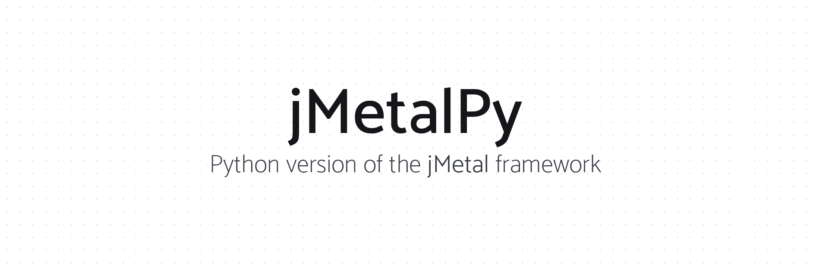
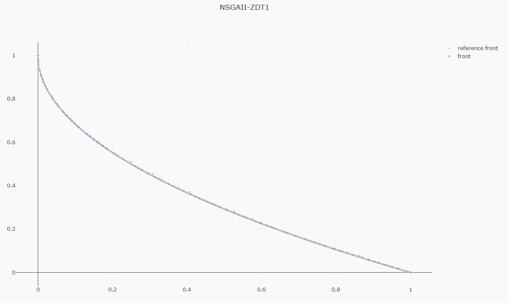
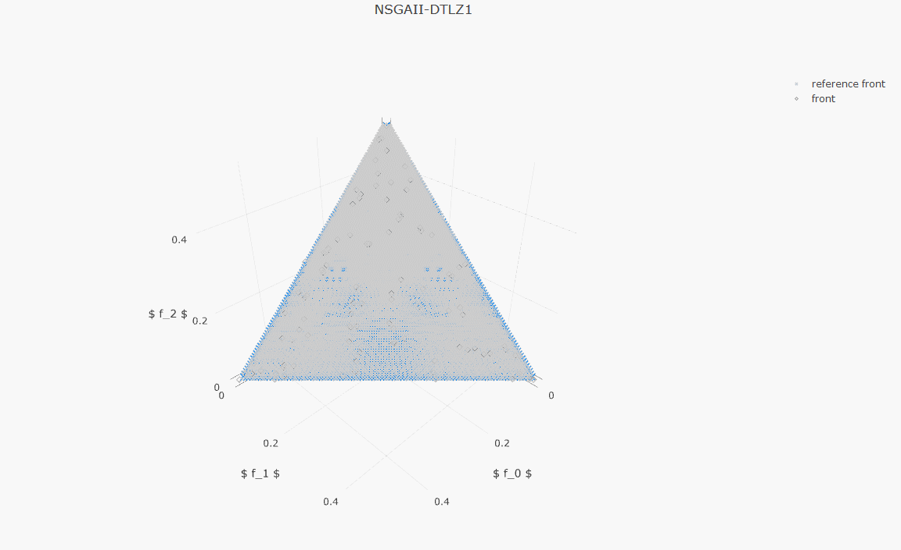
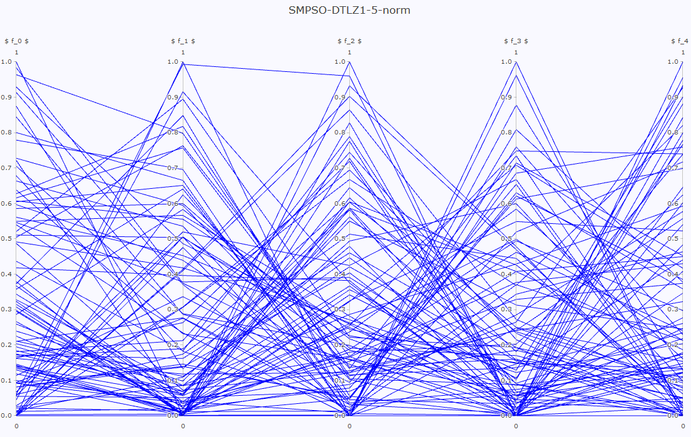
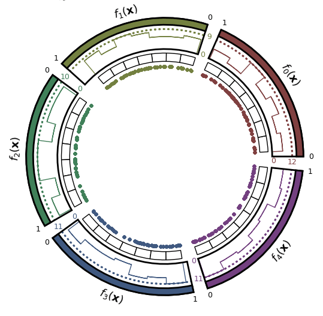

# RF Device Optimization Framework (Bachelor's Thesis, University of Granada)

A modular Python framework for automated, multi-objective optimization of radiofrequency (RF) devices. It couples bio-inspired metaheuristics from [jMetalPy](https://github.com/jMetal/jMetalPy) with the 3D full-wave electromagnetic solver **CST Studio Suite** through COM automation.

> Bachelor's Thesis (TFG), *Framework en Python para optimizar dispositivos RF con algoritmos bioinspirados*, Telecommunication Technologies Engineering, Universidad de Granada (ETSIIT), June 2026. Author: Jesús Mateo Ríos. Supervisors: Andrés Biedma Pérez and Pablo Helio Zapata Cano.

## What it does

- **Decoupled architecture:** the search engine (jMetalPy) is independent of the evaluator, so the optimizer stays unchanged if the CST solver is replaced by another one.
- **Sandboxed evaluation:** every electromagnetic simulation runs in an isolated process with a 600 s timeout; stuck CST instances are killed so the optimization loop keeps going.
- **Geometric pre-filter:** analytical constraints reject physically invalid antenna geometries before launching any simulation.
- **Warm start:** a previous population (`VAR`/`FUN` files) can be injected to resume an interrupted run.
- **Live monitoring:** observers save intermediate results, S11 and axial-ratio plots, and Pareto fronts during the run.

## Case study

Bi-objective design of a circularly polarized microstrip patch antenna at 5 GHz (22 integer-coded geometric variables), minimizing the reflection coefficient (S11) and the axial ratio (AR) for UAV links. NSGA-II and SMPSO were compared with 5,000 evaluations each, in a single-frequency scenario and a 5-frequency scenario (4.8 to 5.2 GHz).

Main results reported in the thesis:

- Best design reaches an axial ratio of **0.41 dB at 5 GHz** with S11 below -10 dB.
- The native CST optimizer, given twice the budget (10,000 evaluations), could not match it. It also lacks a true multi-objective formulation and only supports a weighted sum.
- SMPSO saved about 64 h (single-frequency) and 49 h (multi-frequency) of total compute time compared with NSGA-II.

## Repository layout

| Path | Content |
| --- | --- |
| `codigoTFG/` | Launch scripts, configuration files and Pareto-front post-processing for the thesis experiments (see its README) |
| `src/jmetal/problem/multiobjective/antenaparche.py` | The antenna optimization problem: CST co-simulation, sandbox, constraints |
| `src/jmetal/util/observer.py`, `src/jmetal/util/generator.py` | Custom observers and the file-based population injector (warm start) |
| everything else | jMetalPy base code (see below) |

## Requirements

- Python 3.10 to 3.12 and the dependencies of jMetalPy (`pip install -e .`).
- **CST Studio Suite** with its Python libraries (a licence is required; the thesis used an academic licence). Without CST the problem classes import but real simulations cannot run.
- A CST macro template for the patch antenna. It is not included in this repository.

## Acknowledgements and license

This project builds on [jMetalPy](https://github.com/jMetal/jMetalPy) (A. J. Nebro et al., MIT license), whose original README is kept below. The MIT license of this repository is the original one.

---

# Upstream project: jMetalPy



[](https://github.com/jMetal/jMetalPy/actions/workflows/ci.yml)
[](https://www.python.org/downloads/)
[](https://pypi.org/project/jMetalPy/)
[](https://doi.org/10.1016/j.swevo.2019.100598)
[](https://pypi.org/project/jMetalPy/)
[](https://github.com/psf/black)

A paper introducing jMetalPy is available at: https://doi.org/10.1016/j.swevo.2019.100598

### Table of Contents
- [Installation](#installation)
- [Usage](#hello-world-)
- [Features](#features)
- [Changelog](#changelog)
- [License](#license)

## Installation

You can install the latest version of jMetalPy with `pip`, 

```console
pip install jmetalpy  # or "jmetalpy[distributed]"
```

<details><summary><b>Notes on installing with <tt>pip</tt></b></summary>
<p>

jMetalPy includes features for parallel and distributed computing based on [pySpark](https://spark.apache.org/docs/latest/api/python/index.html) and [Dask](https://dask.org/).

These (extra) dependencies are *not* automatically installed when running `pip`, which only comprises the core functionality of the framework (enough for most users):

```console
pip install jmetalpy
```

This is the equivalent of running: 

```console
pip install "jmetalpy[core]"
```

Other supported commands are listed next:

```console
pip install "jmetalpy[dev]"  # Install requirements for development
pip install "jmetalpy[distributed]"  # Install requirements for parallel/distributed computing
pip install "jmetalpy[complete]"  # Install all requirements
```

</p>
</details>

## Hello, world! 👋

Examples of configuring and running all the included algorithms are located [in the documentation](https://jmetal.github.io/jMetalPy).

```python
from jmetal.algorithm.multiobjective import NSGAII
from jmetal.operator.crossover import SBXCrossover
from jmetal.operator.mutation import PolynomialMutation
from jmetal.problem import ZDT1
from jmetal.util.termination_criterion import StoppingByEvaluations

problem = ZDT1()

algorithm = NSGAII(
    problem=problem,
    population_size=100,
    offspring_population_size=100,
    mutation=PolynomialMutation(probability=1.0 / problem.number_of_variables(), distribution_index=20),
    crossover=SBXCrossover(probability=1.0, distribution_index=20),
    termination_criterion=StoppingByEvaluations(max_evaluations=25000)
)

algorithm.run()
```

We can then proceed to explore the results:

```python
from jmetal.util.solution import get_non_dominated_solutions, print_function_values_to_file, print_variables_to_file

front = get_non_dominated_solutions(algorithm.result())

# save to files
print_function_values_to_file(front, 'FUN.NSGAII.ZDT1')
print_variables_to_file(front, 'VAR.NSGAII.ZDT1')
```

Or visualize the Pareto front approximation produced by the algorithm:

```python
from jmetal.lab.visualization import Plot

plot_front = Plot(title='Pareto front approximation', axis_labels=['x', 'y'])
plot_front.plot(front, label='NSGAII-ZDT1', filename='NSGAII-ZDT1', format='png')
```


## Features
The current release of jMetalPy (v1.8.0) contains the following components:

* Algorithms: local search, genetic algorithm, evolution strategy, simulated annealing, random search, NSGA-II, NSGA-III, SMPSO, OMOPSO, MOEA/D, SMS-EMOA, MOEA/D-DRA, MOEA/D-IEpsilon, GDE3, SPEA2, HYPE, IBEA. Preference articulation-based algorithms (G-NSGA-II, G-GDE3, G-SPEA2, SMPSO/RP); Dynamic versions of NSGA-II, SMPSO, and GDE3.
* Parallel computing based on Apache Spark and Dask.
* Benchmark problems: ZDT1-6, DTLZ1-2, FDA, LZ09, LIR-CMOP, RWA, RE, unconstrained (Kursawe, Fonseca, Schaffer, Viennet2), constrained (Srinivas, Tanaka).
* Encodings: real, binary, permutations.
* Operators: selection (binary tournament, ranking and crowding distance, random, nary random, best solution), crossover (single-point, SBX), mutation (bit-blip, polynomial, uniform, random).
* Quality indicators: hypervolume, additive epsilon, GD, IGD, IGD+.
* Pareto front approximation plotting in real-time, static or interactive.
* Experiment class for performing studies either alone or alongside [jMetal](https://github.com/jMetal/jMetal).
* Pairwise and multiple hypothesis testing for statistical analysis, including several frequentist and Bayesian testing methods, critical distance plots and posterior diagrams.

|  |  |
|-------------- | ----------------  |
|  |  |

## Changelog

* [Current]
  * Added Unimodal Normal Distribution Crossover (UNDX), BLX-Alpha, BLX-Alpha-Beta and Arithmetic crossover operators.
  * Added Levy flight and power-law mutation operators.
* [v.1.8.0] 
  * Add the SMS-EMOA algorithm (based on [moocore](https://multi-objective.github.io/moocore/python/).) 
  * Add the IGD+ quality indicator
  * Add new bencharmk problems:
    * [eqdtlz.py](https://github.com/jMetal/jMetalPy/blob/main/src/jmetal/problem/multiobjective/eqdtlz.py)
    * [misc.py](https://github.com/jMetal/jMetalPy/blob/main/src/jmetal/problem/multiobjective/misc.py)
    * Their reference fronts have been obtained with the [Reference Set Generator](https://doi.org/10.3390/math13101626)  method.
  * The project structure has been changed from [flat to src](https://www.pyopensci.org/python-package-guide/package-structure-code/python-package-structure.html). 
  * The Hypervolume quality indicator implementation relies now on the [moocore project](https://multi-objective.github.io/moocore/python/).
* [v1.7.0] Add RWA benchmark, refactor classes BinarySolution and BinaryProblem.
* [v1.6.0] Refactor class Problem, the single-objective genetic algorithm can solve constrained problems, performance improvements in NSGA-II, generation of Latex tables summarizing the results of the Wilcoxon rank sum test, added a notebook folder with examples.
* [v1.5.7] Use of linters for catching errors and formatters to fix style, minor bug fixes.
* [v1.5.6] Removed warnings when using Python 3.8.
* [v1.5.5] Minor bug fixes.
* [v1.5.4] Refactored quality indicators to accept numpy array as input parameter.
* [v1.5.4] Added [CompositeSolution](https://github.com/jMetal/jMetalPy/blob/master/jmetal/core/solution.py#L111) class to support mixed combinatorial problems. [#69](https://github.com/jMetal/jMetalPy/issues/69)

## License

This project is licensed under the terms of the MIT - see the [LICENSE](LICENSE) file for details.
